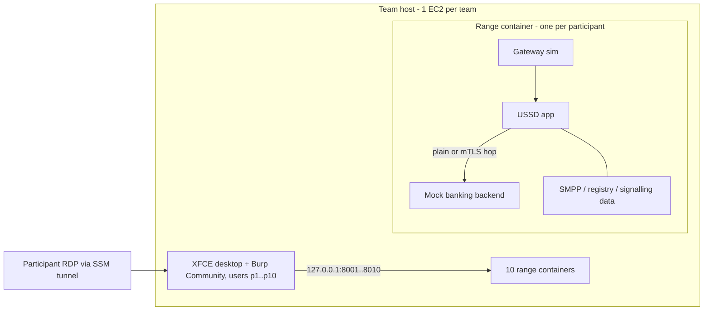

# CCISONFI Track 2 Role B: USSD & Telecom Channel Security Range

Synthetic, isolated training range covering all 10 blueprint scenarios, with a vulnerable and a secured profile, deployed on AWS for 50 participants (5 teams of 10) plus an instructor lab.

## Architecture

* **No inbound ports**: access is SSM Session Manager port-forward (one IAM user per team, restricted by tag to that team's instance). No NAT gateway. Egress only 80/443.
* **Isolation**: each participant has an independent container and data volume; ranges listen on loopback only; participants have no sudo or Docker access and cannot read `/opt/lab`.
* **Instructor lab**: a smaller instance (index 0) built from the full bundle, containing the guide and answer key. Students never receive the instructor bundle.
* **Burp Suite Community** is used: free, sufficient for Proxy/Repeater, and its throttled Intruder supports the brute-force guardrail. Professional is only needed for the scanner, which this course does not use.

## Deploy
```bash
./scripts/package.sh
cd terraform
terraform init
terraform apply -var 'budget_email=you@example.com'      # add -var team_count=N to change team count
terraform output -json team_iam_access_keys                # give each team its own key
```
Activate the cost allocation tag `Project` in Billing for the budget filter to work. Team connect: configure the team's keys with `aws configure`, then
`aws ssm start-session --target <instance-id> --document-name AWS-StartPortForwardingSession --parameters portNumber=3389,localPortNumber=33890` and RDP to `localhost:33890` as `p1`..`p10`.

## Cost (estimates, verify in the AWS Pricing Calculator; eu-west-1 on-demand)
| Item | Rate | Two-day course, 8 h per day |
|---|---|---|
| 5 team hosts, m6i.2xlarge | about $0.43/h | about $34 |
| Instructor host, t3.xlarge | about $0.18/h | about $3 |
| EBS, 6 x 60 GB gp3 | about $32/month | about $2 (prorated) |
| Public IPv4 while running | $0.005/h each | about $1 |
| Setup and test day (about 3 h) | | about $8 |
| **Total** | | **about $50 to $60** |

Controls: stop-after-N-hours auto-shutdown, AWS Budget alerts at 50/80/100% and a forecast alert, no NAT, tags on every resource. To cut cost further use `m6i.xlarge` with `participants_per_team=5` (not recommended with 10 users) or have participants run Burp on their own laptops and tunnel to the range.

**Trade-off:** one shared desktop per team of 10 is cheaper than 50 WorkSpaces (which would cost several times more) but Burp is memory-hungry; 32 GB handles 10 concurrent users. Within a team, users can reach each other's loopback ports; cross-team isolation is complete.

## Teardown checklist
1. `terraform destroy` (removes instances, S3 bucket with contents, IAM users and keys, budget).
2. Confirm in the console: no EC2/EBS left, no S3 bucket `ussd-lab-*`, no IAM users `ussd-lab-team*`.
3. Collect evidence sheets before destroying.

## Pre-class validation checklist
- [ ] `BOOTSTRAP-COMPLETE` on every host (`/var/log/lab-bootstrap.log`)
- [ ] `labctl.sh status` shows 10 containers on each team host
- [ ] Burp launches for `p1` and the browser loads the range
- [ ] Scenario 1 and 2 return tokens in the vulnerable profile; `mode secure` blocks them
- [ ] Each team's SSM tunnel works with that team's key and cannot reach another team's instance
- [ ] Budget email subscription confirmed

## Layout
```
range/       app.py backend.py gen_signalling.py Dockerfile start.sh ...
scripts/     package.sh gen_compose.py labctl.sh
terraform/   main.tf variables.tf outputs.tf userdata.sh.tpl
docs/        INSTRUCTOR_GUIDE.md (answer key) STUDENT_HANDOUT.md
```

## Local environments and tests
```
local/   setup.sh  labctl_local.sh  gen_compose_local.py  README.md  BURP_SETUP.md   (instructor 8101-8103, participant 8001-8010)
tests/   pytest suite, one command: python -m pytest      (see TEST_REPORT.md)
```
